# [springboot]基于SpringBoot的德百商城停车场管理系统

> 🎓 **计算机毕业设计 · [springboot]基于SpringBoot的德百商城停车场管理系统**
>
> 本仓库只放**项目介绍 + 运行截图**（截图是站点带水印的原图，存在仓库 `images/` 里）。
>
> 👉 **完整可运行源码 / 数据库脚本 / 部署文档：[点我获取](https://geekcode.top/archives/springboot-%E5%9F%BA%E4%BA%8ESpringBoot%E7%9A%84%E5%BE%B7%E7%99%BE%E5%95%86%E5%9F%8E%E5%81%9C%E8%BD%A6%E5%9C%BA%E7%AE%A1%E7%90%86%E7%B3%BB%E7%BB%9F?utm_source=github)**
>
> 💬 咨询微信：**ir9372**　|　🌐 更多项目：[极客代码 geekcode.top](https://geekcode.top/?utm_source=github)
>
> 📌 项目详情页：<https://geekcode.top/archives/springboot-%E5%9F%BA%E4%BA%8ESpringBoot%E7%9A%84%E5%BE%B7%E7%99%BE%E5%95%86%E5%9F%8E%E5%81%9C%E8%BD%A6%E5%9C%BA%E7%AE%A1%E7%90%86%E7%B3%BB%E7%BB%9F?utm_source=github>

<table><td width="230" align="center"> <b>扫码加微信 ir9372</b></td><td valign="middle">📦 源码 = 项目介绍 + 全部运行截图 + 数据库 + 部署文档 👉 点上方任意截图，直接跳到 <b>极客代码 geekcode.top</b> 详情页</td></table>

---

<h1>[springboot]基于SpringBoot的德百商城停车场管理系统</h1>
<h2>项目概述</h2>

本项目为“基于SpringBoot的德百商城停车场管理系统”，旨在解决大型商业综合体停车难、车位管理混乱及用户预约体验差等痛点。系统采用前后端分离架构，核心功能涵盖车辆入场离场记录、车位类型与信息管理、在线预约服务以及即时客服沟通。适用人群包括停车场管理员、安保人员及车主用户。技术架构上，后端基于 Spring Boot 框架结合 MyBatis-Plus 进行数据持久层开发，利用 Apache Shiro 实现权限控制；前端采用 Vue.js 构建交互界面。通过数字化手段提升停车场运营效率，实现车位资源的动态调配与透明化管理，为用户提供便捷的停车预约与查询服务，同时为管理人员提供高效的数据监控与后台运维支持。

<h2>技术架构</h2>
<h3>1. 总体架构设计</h3>

系统采用经典的 B/S（浏览器/服务器）架构模式，分为表现层、业务逻辑层和数据访问层。

<a href="https://geekcode.top/archives/springboot-%E5%9F%BA%E4%BA%8ESpringBoot%E7%9A%84%E5%BE%B7%E7%99%BE%E5%95%86%E5%9F%8E%E5%81%9C%E8%BD%A6%E5%9C%BA%E7%AE%A1%E7%90%86%E7%B3%BB%E7%BB%9F?utm_source=github" title="查看完整源码">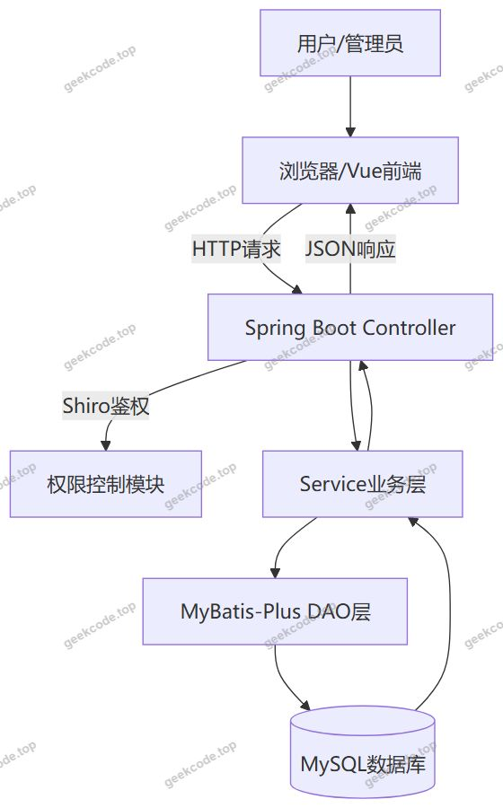</a>

<h3>2. 核心技术选型理由</h3>
<ul>
<li><strong>后端框架 (Spring Boot)</strong>：作为核心容器，简化了配置流程，内置 Tomcat 服务器，快速搭建 RESTful API 接口，确保系统的高可用性与扩展性。</li>
<li><strong>持久层框架 (MyBatis-Plus)</strong>：在 MyBatis 基础上增强，提供了通用的 CRUD 操作和条件构造器，大幅减少 SQL 编写工作量，提高开发效率，同时保持对复杂查询的支持能力。</li>
<li><strong>安全框架 (Apache Shiro)</strong>：用于处理认证（Authentication）和授权（Authorization）。鉴于停车场系统涉及敏感的用户信息和车辆数据，Shiro 提供了细粒度的权限控制机制，确保不同角色只能访问其授权范围内的资源。</li>
<li><strong>数据库 (MySQL)</strong>：关系型数据库存储结构化数据，如用户信息、车位状态、预约记录等，保证数据的一致性和完整性。</li>
<li><strong>前端技术 (Vue.js)</strong>：虽然代码上下文主要展示后端依赖，但根据 <code>vue-integrated</code> 项目类型及路由结构，前端使用 Vue.js 构建单页面应用（SPA），实现组件化开发和高效的 DOM 更新，提升用户体验。</li>
</ul>
<h3>3. 数据库设计要点</h3>

数据库设计遵循第三范式，主要实体包括：

<ul>
<li><strong>用户表 (yonghu)</strong>：存储注册用户的账号、密码、联系方式等信息。</li>
<li><strong>车位类型表 (cheweileixing)</strong>：定义车位的类别（如标准位、VIP位、新能源位等）及其属性。</li>
<li><strong>车位信息表 (cheweixinxi)</strong>：记录具体车位编号、所属区域、当前状态（空闲/占用）及关联的车位类型。</li>
<li><strong>车辆预约表 (cheweiyuyue)</strong>：记录用户发起的预约请求，包含车牌号、预约时间、状态等。</li>
<li><strong>车辆入场记录表 (cheliangruchang)</strong>：记录车辆进入停车场的时间、入口通道等信息。</li>
<li><strong>车辆离场记录表 (chelianglichang)</strong>：记录车辆离开停车场的时间、出口通道及费用结算信息。</li>
<li><strong>公告信息表 (news)</strong>：发布停车场相关通知或活动信息。</li>
<li><strong>聊天消息表 (chat)</strong>：存储用户与客服之间的即时通讯记录。</li>
</ul>
<h2>功能模块</h2>

根据提供的路由配置与截图列表，系统功能划分为前台用户端和后台管理端两大模块。

<h3>1. 前台用户端功能</h3>

前台面向普通车主用户，提供自助服务与信息浏览功能。

<ul>
<li><strong>首页展示 (<code>/index/newsList</code>)</strong>：展示最新公告信息，让用户了解停车场最新动态。</li>
<li><strong>用户中心 (<code>/index/yonghuCenter</code>, <code>/index/yonghuDetail</code>)</strong>：查看和管理个人基本信息，支持修改资料。</li>
<li><strong>用户注册 (<code>/yonghuRegister</code>, <code>/index/yonghuAdd</code>)</strong>：新用户填写信息进行注册，获取系统使用权限。</li>
<li><strong>车位类型查询 (<code>/index/cheweileixingList</code>, <code>/index/cheweileixingDetail</code>)</strong>：浏览不同类型的车位介绍及收费标准。</li>
<li><strong>车位信息查询 (<code>/index/cheweixinxiList</code>, <code>/index/cheweixinxiDetail</code>)</strong>：实时查看各区域车位的剩余数量及分布情况。</li>
<li><strong>车位预约 (<code>/index/cheweiyuyueList</code>, <code>/index/cheweiyuyueAdd</code>)</strong>：用户可在线选择车位并提交预约申请，查看历史预约记录。</li>
<li><strong>车辆入场记录 (<code>/index/cheliangruchangList</code>, <code>/index/cheliangruchangDetail</code>)</strong>：查看个人的车辆入场历史记录。</li>
<li><strong>车辆离场记录 (<code>/index/chelianglichangList</code>, <code>/index/chelianglichangDetail</code>)</strong>：查看个人的车辆离场及缴费历史记录。</li>
</ul>
<h3>2. 后台管理端功能</h3>

后台面向系统管理员，提供全面的数据管理与业务处理能力。

<ul>
<li><strong>登录页 (<code>admin</code>)</strong>：管理员身份验证入口。</li>
<li><strong>首页仪表盘 (<code>admin</code>)</strong>：展示关键业务数据统计概览。</li>
<li><strong>公告管理 (<code>/news</code>)</strong>：发布、编辑、删除停车场通知信息，同步至前台展示。</li>
<li><strong>用户管理 (<code>/yonghu</code>)</strong>：查看注册用户列表，管理用户状态，重置密码或禁用违规账号。</li>
<li><strong>车位类型管理 (<code>/cheweileixing</code>)</strong>：维护车位分类字典，设置不同类型车位的属性参数。</li>
<li><strong>车位信息管理 (<code>/cheweixinxi</code>)</strong>：录入具体车位物理信息，实时更新车位状态（空闲/占用），支持批量导入导出。</li>
<li><strong>车辆预约管理 (<code>/cheweiyuyue</code>)</strong>：审核用户提交的预约请求，处理取消或确认预约的操作，协调车位资源。</li>
<li><strong>车辆入场管理 (<code>/cheliangruchang</code>)</strong>：手动录入或同步自动识别的车辆入场数据，异常记录处理。</li>
<li><strong>车辆离场管理 (<code>/chelianglichang</code>)</strong>：处理车辆离场结算，记录离场时间与费用，生成财务报表基础数据。</li>
<li><strong>客服聊天 (<code>/chat</code>)</strong>：管理员在此模块回复用户咨询，提供在线技术支持与服务引导。</li>
<li><strong>系统配置 (<code>/config</code>)</strong>：修改系统全局参数，如站点名称、Logo、联系电话等基础设置。</li>
</ul>
<h2>用户角色与权限</h2>

本系统基于 Apache Shiro 框架实现权限控制，主要划分两类角色：<strong>普通用户</strong>和<strong>系统管理员</strong>。

<h3>1. 普通用户 (User)</h3>
<ul>
<li><strong>访问范围</strong>：仅限前台路由。</li>
<li><strong>权限描述</strong>：</li>
<li><strong>未登录状态</strong>：仅能浏览首页公告、查看车位类型和车位信息的公开列表。</li>
<li><strong>已登录状态</strong>：</li>
<li><strong>个人中心</strong>：查看和修改个人信息。</li>
<li><strong>预约服务</strong>：创建新的车位预约，查看自己的预约历史详情。</li>
<li><strong>记录查询</strong>：查看属于自己的车辆入场和离场记录详情。</li>
<li><strong>客服互动</strong>：发起聊天请求，与管理员进行沟通。</li>
<li><strong>限制</strong>：无法访问任何后台管理接口，无法修改其他用户数据，无法直接更改车位状态。</li>
</ul>
<h3>2. 系统管理员 (Admin)</h3>
<ul>
<li><strong>访问范围</strong>：仅限后台路由。</li>
<li><strong>权限描述</strong>：</li>
<li><strong>全量数据管理</strong>：拥有对所有业务实体（用户、车位、预约、出入场记录、公告）的增删改查权限。</li>
<li><strong>业务审批</strong>：负责审核车辆预约请求，决定批准或拒绝。</li>
<li><strong>内容发布</strong>：发布公告信息，维护系统配置参数。</li>
<li><strong>客户服务</strong>：通过聊天模块响应用户咨询。</li>
<li><strong>安全控制</strong>：管理用户账户状态，确保系统数据安全。</li>
</ul>
<h2>项目特色与创新点</h2>
<ol>
<li><strong>全流程闭环管理</strong>：系统覆盖了从“车位查询 -&gt; 在线预约 -&gt; 车辆入场 -&gt; 停车计费 -&gt; 车辆离场”的完整业务链条，实现了停车场运营的数字化闭环，减少了人工干预错误。</li>
<li><strong>即时通讯集成</strong>：在停车场管理系统中创新性地集成了 <code>/chat</code> 客服聊天模块。这打破了传统停车场系统仅提供静态信息的局限，允许用户在遇到取票失败、车位纠纷等问题时，能实时联系管理员解决，显著提升了用户满意度和应急响应速度。</li>
<li><strong>精细化车位调度</strong>：通过区分“车位类型”与“具体车位信息”，系统支持更灵活的资源配置。管理员可根据实际场景动态调整特定车位的属性，用户则可根据需求（如是否需要充电桩、车型大小）精准匹配车位，提高了车位周转率。</li>
<li><strong>前后端分离的安全架构</strong>：采用 Spring Boot + Shiro 的后端架构配合 Vue 前端，不仅提升了系统的响应速度和用户体验，还通过 Shiro 的 Realm 机制实现了严格的会话管理和权限校验，有效防止越权访问，保障了商业数据的隐私与安全。</li>
</ol>
<h2>部署环境</h2>

为确保系统正常运行，需准备以下软硬件环境：

<h3>1. 硬件环境</h3>
<ul>
<li><strong>CPU</strong>：建议 Intel Core i5 及以上处理器。</li>
<li><strong>内存</strong>：建议 8GB 及以上 RAM。</li>
<li><strong>硬盘</strong>：建议 SSD 固态硬盘，预留至少 50GB 空间用于系统及数据存储。</li>
</ul>
<h3>2. 软件环境</h3>
<ul>
<li><strong>操作系统</strong>：Windows 10/11, Linux (CentOS 7+, Ubuntu 20.04+) 或 macOS。</li>
<li><strong>Java 运行环境</strong>：JDK 1.8 或 JDK 11（推荐 JDK 1.8，兼容性好且稳定）。</li>
<li><strong>数据库</strong>：MySQL 5.7 或 MySQL 8.0。需安装并启动服务，创建对应数据库实例。</li>
<li><strong>Node.js</strong>：版本建议 v12.x 或 v14.x（用于前端 Vue 项目的编译打包）。</li>
<li><strong>Maven</strong>：版本 3.6+，用于后端 Java 项目的依赖管理和构建。</li>
<li><strong>Web 服务器</strong>：内置 Tomcat（由 Spring Boot Starter Web 提供），无需单独安装外部 Tomcat。若生产环境部署，可使用 Nginx 作为反向代理服务器。</li>
<li><strong>浏览器</strong>：Chrome, Edge, Firefox 等现代主流浏览器。</li>
</ul>
<h3>3. 部署步骤简述</h3>
<ol>
<li><strong>数据库初始化</strong>：导入项目提供的 <code>.sql</code> 脚本文件到 MySQL 数据库中。</li>
<li><strong>后端部署</strong>：修改 <code>application.yml</code> 中的数据库连接信息（URL, Username, Password），使用 Maven 命令 <code>mvn clean package</code> 打包成 jar 文件，并通过 <code>java -jar</code> 命令启动服务。</li>
<li><strong>前端部署</strong>：进入前端目录，执行 <code>npm install</code> 安装依赖，随后执行 <code>npm run build</code> 生成静态资源文件。将生成的 <code>dist</code> 文件夹内容部署到 Web 服务器（如 Nginx）或直接由后端 Spring Boot 静态资源目录托管（视具体配置而定）。</li>
<li><strong>访问测试</strong>：打开浏览器访问配置的域名或 IP 地址，进行登录和功能测试。</li>
</ol>
<h2>五、技术特性</h2>
<ul>
<li>前后端集成部署，前端资源打包至后端 static 目录</li>
<li>使用 MyBatis-Plus 简化数据访问层开发</li>
<li>集成 Shiro 权限框架实现角色权限控制</li>
</ul>
<h2>六、功能模块截图</h2>
<h3>前台用户端</h3>
<h4>前台-首页</h4>

<a href="https://geekcode.top/archives/springboot-%E5%9F%BA%E4%BA%8ESpringBoot%E7%9A%84%E5%BE%B7%E7%99%BE%E5%95%86%E5%9F%8E%E5%81%9C%E8%BD%A6%E5%9C%BA%E7%AE%A1%E7%90%86%E7%B3%BB%E7%BB%9F?utm_source=github" title="查看完整源码">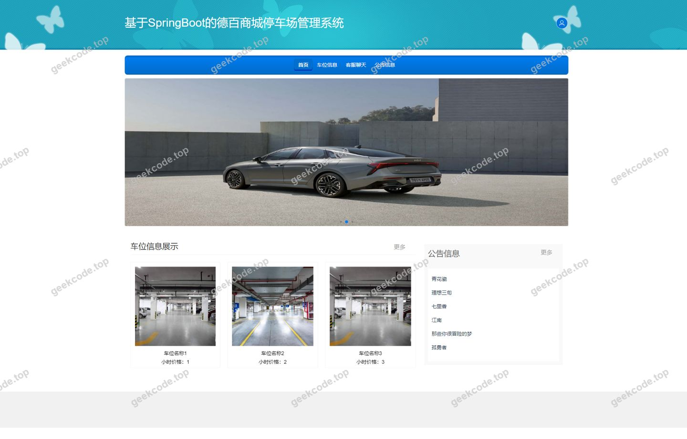</a>

<h4>前台-登录</h4>

<a href="https://geekcode.top/archives/springboot-%E5%9F%BA%E4%BA%8ESpringBoot%E7%9A%84%E5%BE%B7%E7%99%BE%E5%95%86%E5%9F%8E%E5%81%9C%E8%BD%A6%E5%9C%BA%E7%AE%A1%E7%90%86%E7%B3%BB%E7%BB%9F?utm_source=github" title="查看完整源码">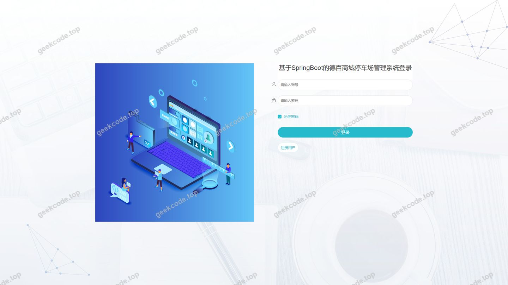</a>

<h4>前台-用户注册</h4>

<a href="https://geekcode.top/archives/springboot-%E5%9F%BA%E4%BA%8ESpringBoot%E7%9A%84%E5%BE%B7%E7%99%BE%E5%95%86%E5%9F%8E%E5%81%9C%E8%BD%A6%E5%9C%BA%E7%AE%A1%E7%90%86%E7%B3%BB%E7%BB%9F?utm_source=github" title="查看完整源码">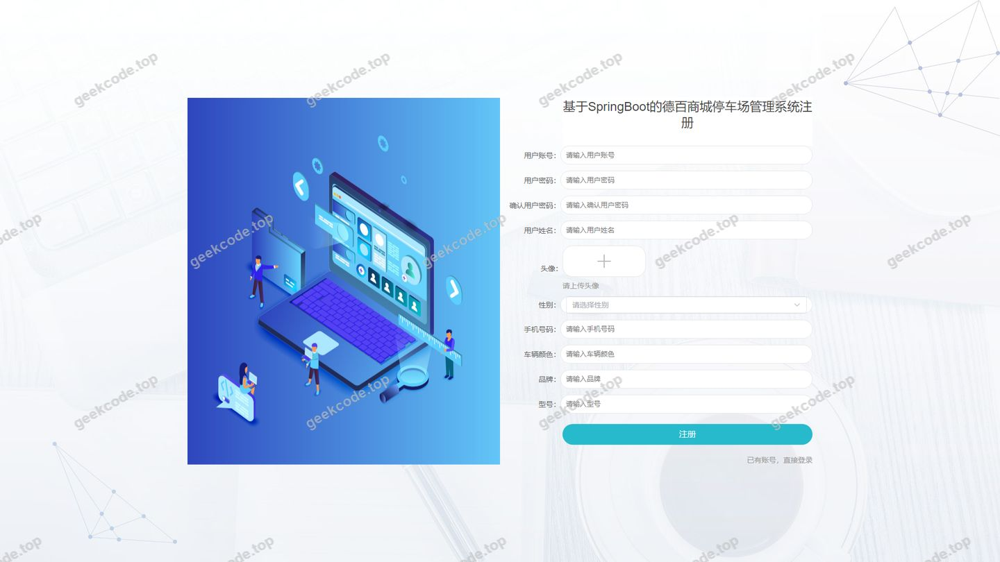</a>

<h3>后台管理端</h3>
<h4>后台-车辆离场</h4>

<a href="https://geekcode.top/archives/springboot-%E5%9F%BA%E4%BA%8ESpringBoot%E7%9A%84%E5%BE%B7%E7%99%BE%E5%95%86%E5%9F%8E%E5%81%9C%E8%BD%A6%E5%9C%BA%E7%AE%A1%E7%90%86%E7%B3%BB%E7%BB%9F?utm_source=github" title="查看完整源码">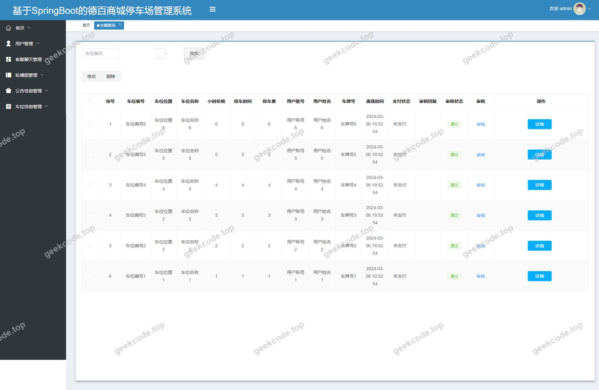</a>

<h4>后台-车位类型</h4>

<a href="https://geekcode.top/archives/springboot-%E5%9F%BA%E4%BA%8ESpringBoot%E7%9A%84%E5%BE%B7%E7%99%BE%E5%95%86%E5%9F%8E%E5%81%9C%E8%BD%A6%E5%9C%BA%E7%AE%A1%E7%90%86%E7%B3%BB%E7%BB%9F?utm_source=github" title="查看完整源码">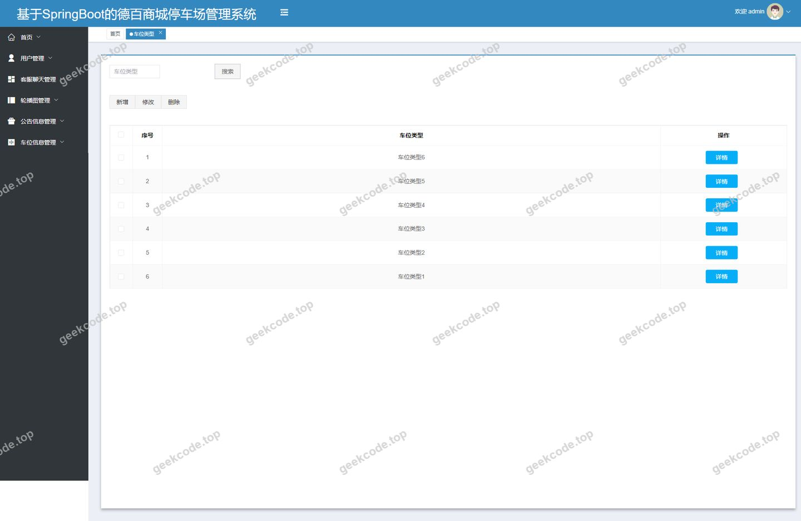</a>

<h4>后台-车位信息</h4>

<a href="https://geekcode.top/archives/springboot-%E5%9F%BA%E4%BA%8ESpringBoot%E7%9A%84%E5%BE%B7%E7%99%BE%E5%95%86%E5%9F%8E%E5%81%9C%E8%BD%A6%E5%9C%BA%E7%AE%A1%E7%90%86%E7%B3%BB%E7%BB%9F?utm_source=github" title="查看完整源码">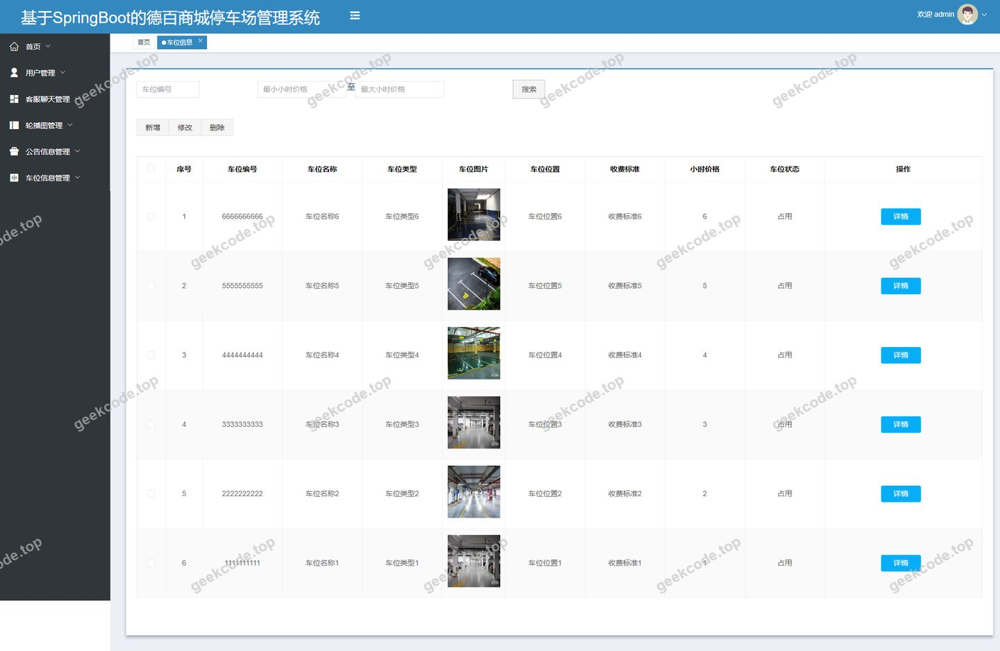</a>

<h4>后台-登录页</h4>

<h4>后台-公告信息</h4>

<a href="https://geekcode.top/archives/springboot-%E5%9F%BA%E4%BA%8ESpringBoot%E7%9A%84%E5%BE%B7%E7%99%BE%E5%95%86%E5%9F%8E%E5%81%9C%E8%BD%A6%E5%9C%BA%E7%AE%A1%E7%90%86%E7%B3%BB%E7%BB%9F?utm_source=github" title="查看完整源码">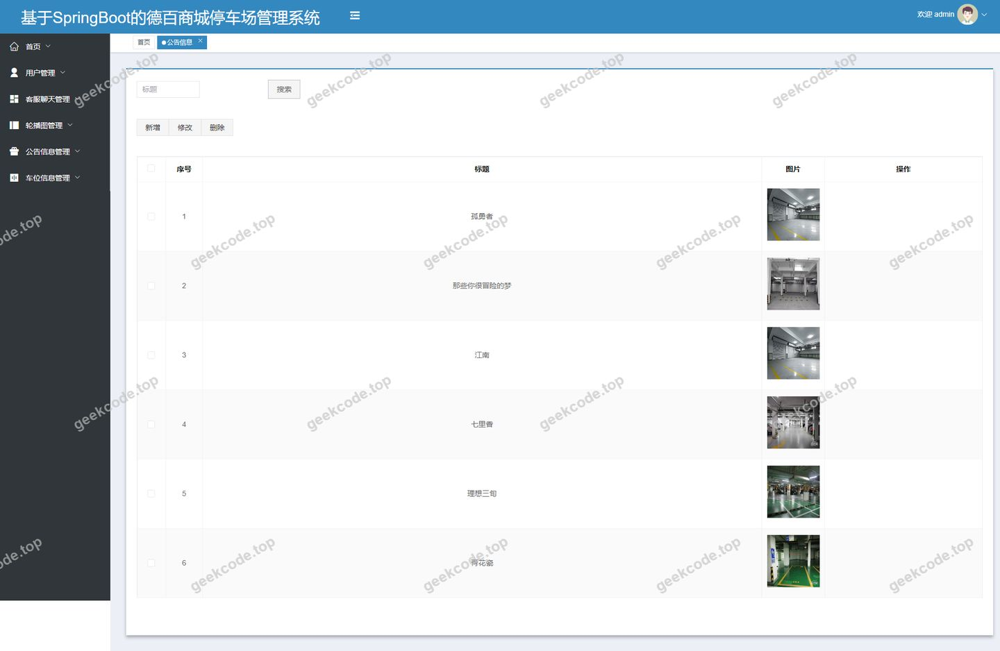</a>

<h4>后台-客服聊天</h4>

<a href="https://geekcode.top/archives/springboot-%E5%9F%BA%E4%BA%8ESpringBoot%E7%9A%84%E5%BE%B7%E7%99%BE%E5%95%86%E5%9F%8E%E5%81%9C%E8%BD%A6%E5%9C%BA%E7%AE%A1%E7%90%86%E7%B3%BB%E7%BB%9F?utm_source=github" title="查看完整源码">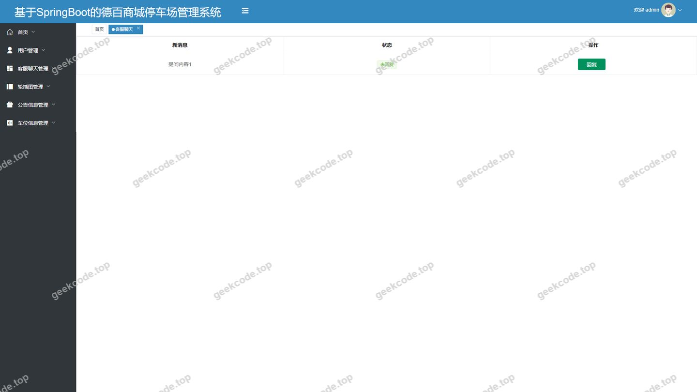</a>

<h4>页面-首页</h4>

<a href="https://geekcode.top/archives/springboot-%E5%9F%BA%E4%BA%8ESpringBoot%E7%9A%84%E5%BE%B7%E7%99%BE%E5%95%86%E5%9F%8E%E5%81%9C%E8%BD%A6%E5%9C%BA%E7%AE%A1%E7%90%86%E7%B3%BB%E7%BB%9F?utm_source=github" title="查看完整源码">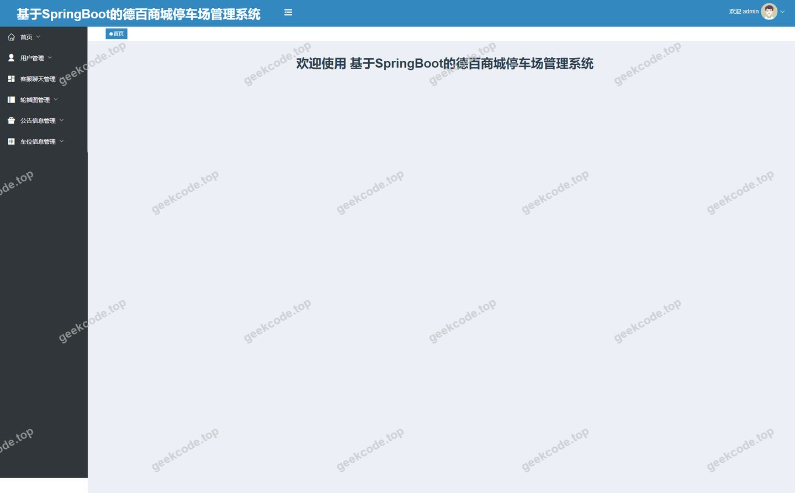</a>

<h4>后台-用户</h4>

<a href="https://geekcode.top/archives/springboot-%E5%9F%BA%E4%BA%8ESpringBoot%E7%9A%84%E5%BE%B7%E7%99%BE%E5%95%86%E5%9F%8E%E5%81%9C%E8%BD%A6%E5%9C%BA%E7%AE%A1%E7%90%86%E7%B3%BB%E7%BB%9F?utm_source=github" title="查看完整源码">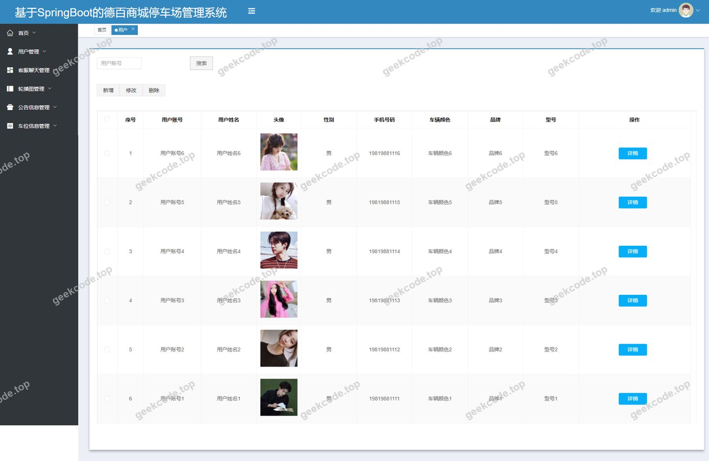</a>

---

## 获取完整源码

| 项目 | 说明 |
| --- | --- |
| 项目名 | [springboot]基于SpringBoot的德百商城停车场管理系统 |
| 运行截图 | 本文 12 张（站点带水印原图，仓库 `images/` 目录） |
| 完整源码 | [https://geekcode.top/archives/springboot-%E5%9F%BA%E4%BA%8ESpringBoot%E7%9A%84%E5%BE%B7%E7%99%BE%E5%95%86%E5%9F%8E%E5%81%9C%E8%BD%A6%E5%9C%BA%E7%AE%A1%E7%90%86%E7%B3%BB%E7%BB%9F?utm_source=github](https://geekcode.top/archives/springboot-%E5%9F%BA%E4%BA%8ESpringBoot%E7%9A%84%E5%BE%B7%E7%99%BE%E5%95%86%E5%9F%8E%E5%81%9C%E8%BD%A6%E5%9C%BA%E7%AE%A1%E7%90%86%E7%B3%BB%E7%BB%9F?utm_source=github) |
| 咨询微信 | **ir9372**（备注：jingpin-yuanma） |
| 更多项目 | [极客代码 geekcode.top](https://geekcode.top/?utm_source=github) |

> 需要源码、部署、改配置、跑不起来等问题，加微信 ir9372 沟通，说明项目名即可。
